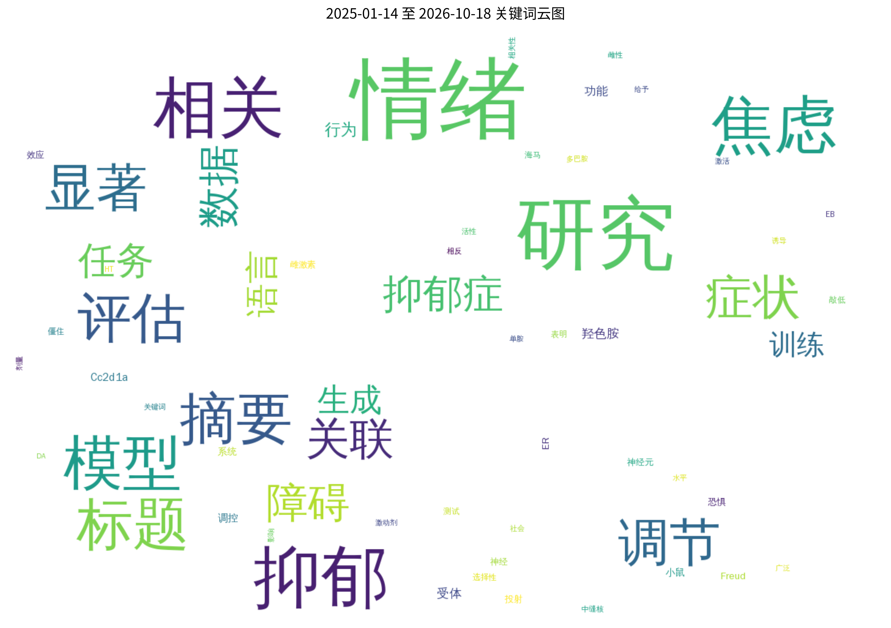
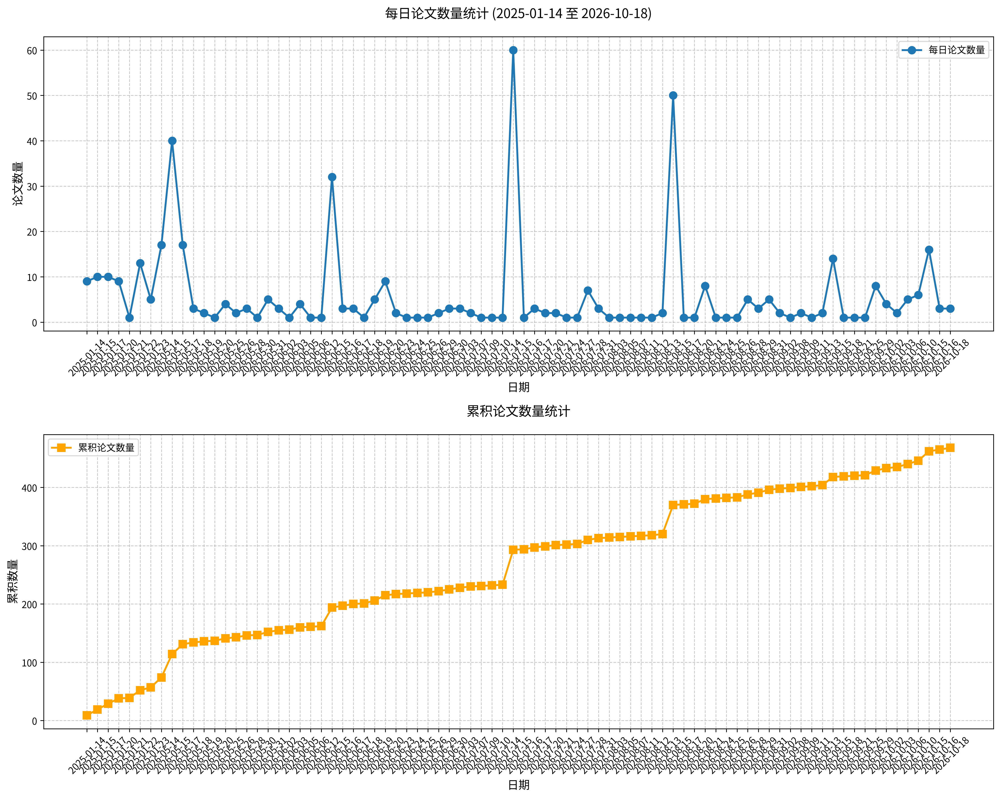

# 心理学相关论文日报 (2026-10-19)

## 📊 今日论文统计
- 总论文数：1
- 热门领域：综合领域

## 📝 论文详情

### 1. 正念觉知在青少年社交外貌焦虑与社交媒体成瘾之间的中介作用

**原文标题：** Mindful Awareness as a Mediator Between Social Appearance Anxiety and Social Media Addiction in Adolescents.

**摘要：**
目的：青春期是身份形成和社会发展的关键时期，社交媒体可能塑造外貌感知和社会接纳。社交外貌焦虑可能与更高的社交媒体成瘾易感性相关，而正念觉知可能与较低的这种风险水平相关。本研究检验了正念觉知在青少年社交外貌焦虑与社交媒体成瘾之间的中介作用。方法：样本包括2024-2025学年土耳其东部383名自愿参与的中学学生。参与者完成了社交外貌焦虑、正念觉知和社交媒体成瘾的标准化测量。结果：社交外貌焦虑与社交媒体成瘾呈正相关，与正念觉知呈负相关；正念觉知也与成瘾呈负相关。结论：中介结果表明存在部分中介效应，提示基于正念的干预可能减少外貌焦虑并促进青少年更健康的社交媒体使用。研究结果凸显了正念觉知作为预防靶点的价值。

**关键词：** 正念觉知；社交外貌焦虑；社交媒体成瘾；青少年；中介作用

**论文链接：** [PubMed](https://pubmed.ncbi.nlm.nih.gov/42879693/)

---

## 🔍 关键词云图

## 📈 近期论文趋势

## 🎙️ 语音播报
- [收听今日论文解读](../audio/2026-10-19_daily_papers.mp3)