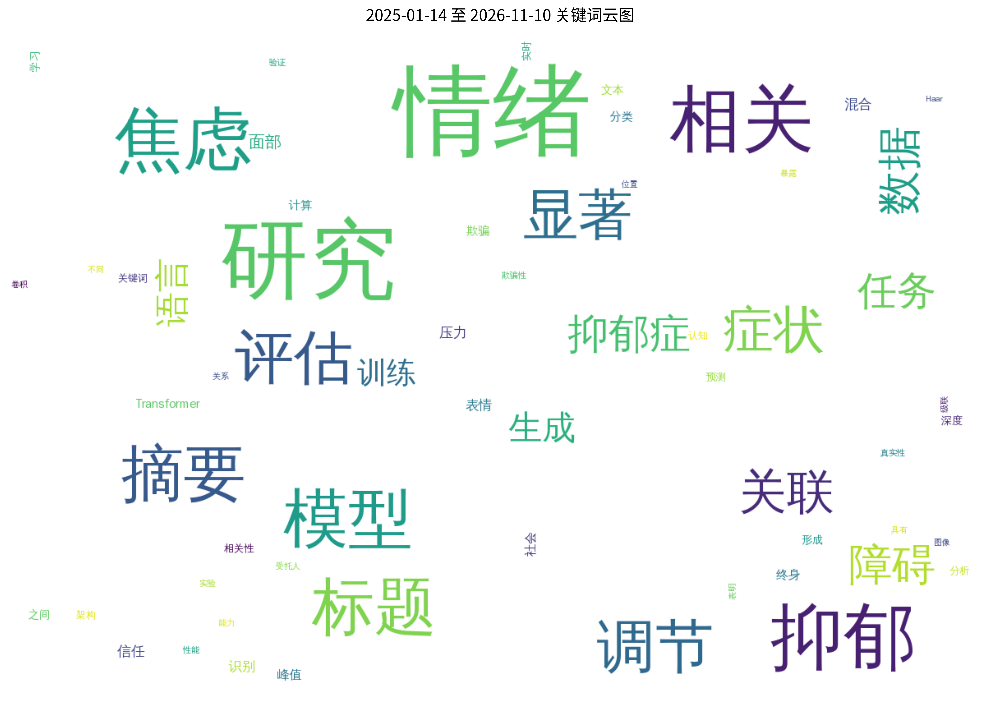
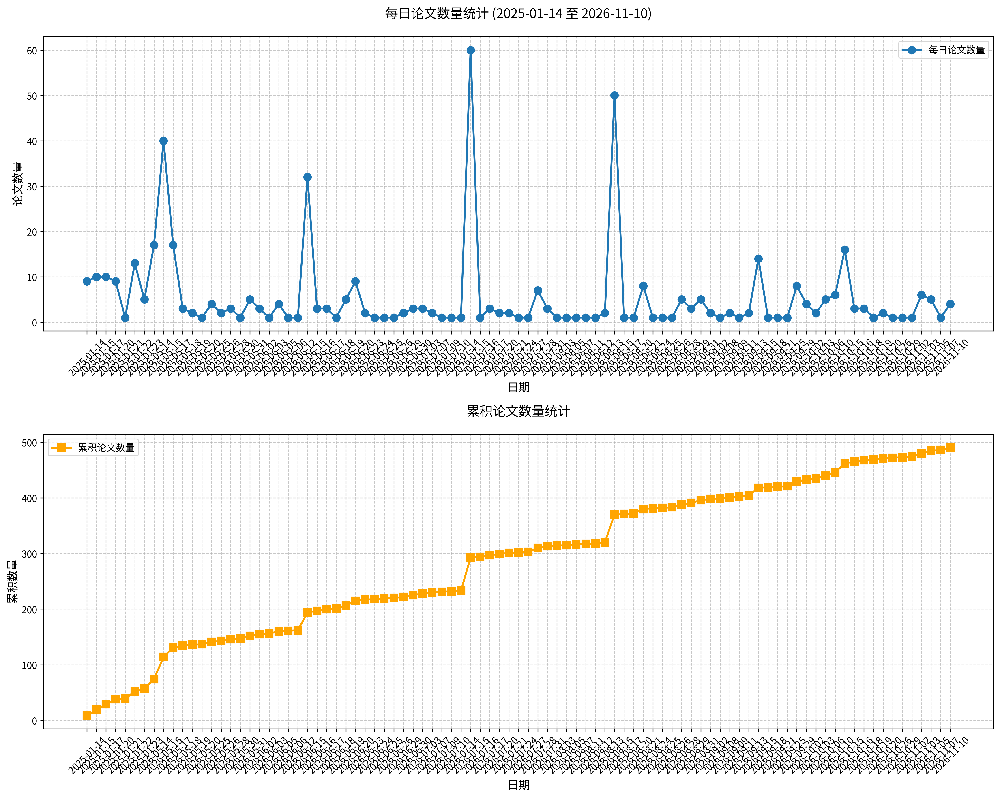

# 心理学相关论文日报 (2026-11-10)

## 📊 今日论文统计
- 总论文数：4
- 热门领域：Vision, Transformer

## 📝 论文详情

### 1. 终身压力源暴露与动态互动中信任形成和社会学习的改变有关

**原文标题：** Lifetime stressor exposure is associated with altered trust formation and social learning in dynamic interactions.

**摘要：**
尽管信任是社会互动的基础，但终身压力源暴露与信任背后的认知过程之间的关系仍知之甚少。本研究使用压力和逆境量表（STRAIN）评估累积的终身压力源暴露，结合改编的重复信任博弈和计算建模（分层高斯滤波），在168名成年人中考察了生命历程中所经历的压力源与信任动态的三个核心方面——初始信任形成、对他人意图的学习以及对可信度变化的适应——之间的关系。更高的终身压力与更强的消极性偏差、更低的初始信任以及对他人意图更高的不确定性相关，这些增加是普遍性的而非特定于伙伴类型。这些更为悲观的先验信念并未伴随对伙伴解读能力的下降：更高的终身压力与对亲社会受托人和自私受托人之间更大的区分能力相关，这仅由对自私受托人投资的减少所驱动。计算分析进一步表明信念波动性更大，这与模型隐含的对感知可信度的更快更新相一致。这些发现提供了新的证据，表明终身压力与一种符合信任背后认知机制重新校准而非退化的特征 profile 相关，并对关系形成和社会功能具有潜在后果。它们还提供了一个基于计算的框架来理解逆境与社会认知之间的关联，并为未来的实验工作产生了可检验的预测。

**关键词：** 终身压力；信任形成；社会学习；计算建模；社会认知

**论文链接：** [PubMed](https://pubmed.ncbi.nlm.nih.gov/42970690/)

---

### 2. 基于Transformer模型的混合情绪面部表情识别

**原文标题：** Mixed Emotion Recognition Through Facial Expression using Transformer-Based Model

**摘要：**
基本面部表情如愤怒、厌恶、惊讶、快乐、恐惧和悲伤可以表达情绪。然而，在对话中，复合情绪可以形成混合面部情绪，即基本情绪的组合，这种混合情绪识别更为复杂，是一个尚未得到充分研究的新近课题，尽管数据集已包含混合情绪。本研究旨在实现并微调基于Transformer的模型（如Vision Transformer、Swin Transformer v2）以及基于ConvNet的模型（如ConvNeXt架构），利用IMED数据集通过人脸识别和辨认混合情绪。研究测试了各模型间不同的超参数微调配置。结果表明，Vision Transformer架构在面部表情混合情绪识别中优于其他模型，测试准确率达到79.37%，而Swin Transformer v2模型为65.36%，ConvNeXt为74.77%。

**关键词：** 混合情绪识别；面部表情；Transformer模型；深度学习；情绪计算

**论文链接：** [Crossref](https://doi.org/10.19139/soic-2310-5070-2103)

---

### 3. 欺骗性与真实性文本中情绪峰值的位置

**原文标题：** The Location of Maximum Emotion in Deceptive and Truthful Texts

**摘要：**
元分析证据表明，情绪的语言模式会泄露欺骗，但目前尚不清楚谎言与真话中情绪峰值的位置是否对揭示欺骗具有重要意义。我们通过在句子层面进行分析，定位欺骗性文本与真实性文本中情绪最为显著的位置，从而为欺骗研究文献作出贡献。使用两个公开数据集——新闻文章（研究1）和酒店评论（研究2）——我们发现，情绪峰值出现在欺骗性文本的开头部分，而真实性文本的情绪峰值则出现得较晚。除了在不同情境中证明该效应外，我们还使用了两种不同的情绪测量方法，并按效价对结果进行分离，每次均重复验证了情绪峰值效应。情绪峰值的预测效力在各数据集中介于54%至56%之间，这一比率与大多数采用50-50谎言-真话基线率的欺骗研究一致。本文还讨论了对未来研究和欺骗理论的意义。

**关键词：** 欺骗检测；情绪峰值；文本分析；效价；语言线索

**论文链接：** [Crossref](https://doi.org/10.1177/1948550620949730)

---

### 4. 混合面部表情识别（FER2013）模型用于实时情绪分类与预测

**原文标题：** Hybrid facial expression recognition (FER2013) modelfor real-time emotion classification and prediction

**摘要：**
面部表情识别是人工智能、游戏、人机交互（HCI）和心理学等多个领域的重要研究课题。本文提出了一种混合面部表情识别模型，该模型由深度卷积神经网络（DCNN）和Haar级联深度学习架构组成，旨在将实时和数字面部图像分类为所考虑的七种面部情绪类别之一。研究中采用的DCNN具有更多的卷积层、ReLU激活函数和多核结构，以增强滤波深度和面部特征提取能力。此外，Haar级联模型被共同用于检测实时图像和视频帧中的面部特征。研究使用Kaggle数据库（FER2013）中的灰度图像，并利用图形处理器（GPU）计算加速训练和验证过程。应用预处理和数据增强技术以提高训练效率和分类性能。实验结果表明，与当前最先进（SoTA）的实验和研究相比，分类性能显著提升。此外，与其他传统模型相比，本文验证了所提出的架构在分类性能上更优，提升幅度最高达6%，总准确率达70%，且执行时间更短，为2，098.8秒。

**关键词：** 面部表情识别；深度卷积神经网络；情绪分类；Haar级联；实时情绪预测

**论文链接：** [Crossref](https://doi.org/10.54646/bijiam.2022.09)

---

## 🔍 关键词云图

## 📈 近期论文趋势

## 🎙️ 语音播报
- [收听今日论文解读](../audio/2026-11-10_daily_papers.mp3)