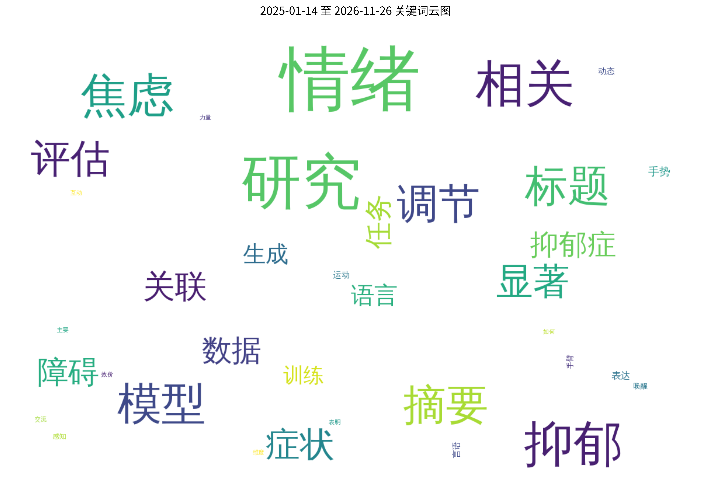
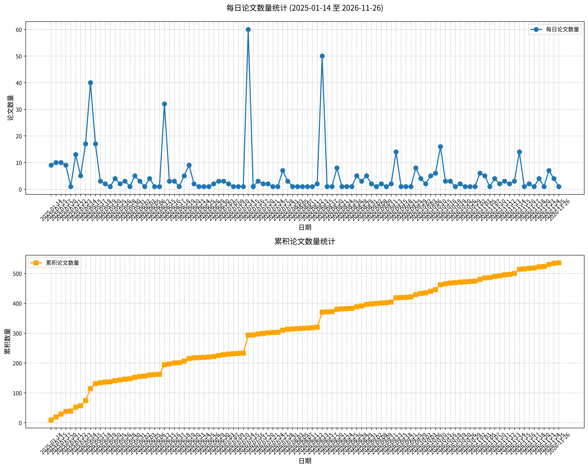

# 心理学相关论文日报 (2026-11-26)

## 📊 今日论文统计
- 总论文数：1
- 热门领域：综合领域

## 📝 论文详情

### 1. 情绪非言语表达中手势动态的感知

**原文标题：** Perceived Gesture Dynamics in Nonverbal Expression of Emotion

**摘要：**
近期的判断研究表明，人们能够相当准确地将他人的身体表达归因于情绪状态。然而，哪些运动特质是突显的，以及这如何适用于言语互动过程中的情绪手势，尚不清楚。本研究考察了在唤醒度、效价和力量三个主要情绪维度上变化的情绪表达如何影响动态手臂手势的感知。十名专业演员在基于情景的社会互动情境中表演了12种情绪。参与者（N=43）在声音静音、面部模糊的条件下，对情绪表达在六个与情绪相关的时空手势手臂运动特征（运动量、运动速度、力度、流畅度、幅度和高度/垂直位置）上进行评分。研究发现，唤醒度和力量是手势动态感知的强决定因素，而积极或消极情绪之间的差异则不太明显。这些结果证实了手臂运动在传达主要情绪维度中的重要性，并表明手势是多模态非言语情绪交流的组成部分。

**关键词：** 情绪表达；手势动态；非言语交流；唤醒度；效价

**论文链接：** [Crossref](https://doi.org/10.1068/p7364)

---

## 🔍 关键词云图

## 📈 近期论文趋势

## 🎙️ 语音播报
- [收听今日论文解读](../audio/2026-11-26_daily_papers.mp3)